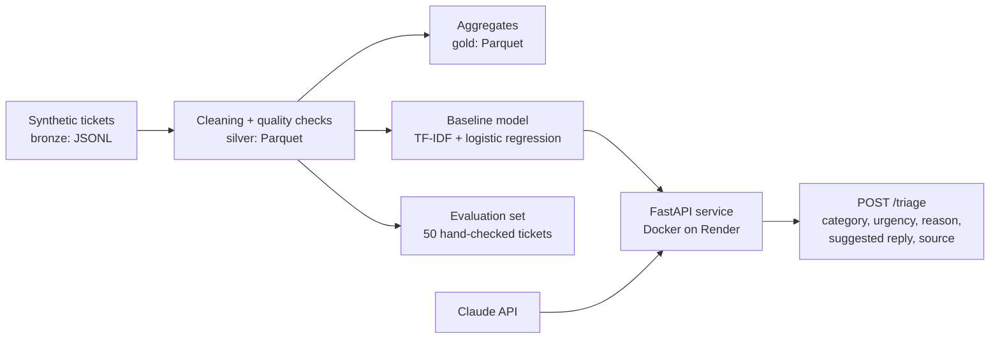

# IT Support Ticket Triage

A small, production-style service that classifies IT support tickets by **category** and **urgency** and suggests a first reply to the employee. It compares an LLM (Claude) with a simple machine learning baseline, uses the baseline as a fallback, and runs as a Dockerised API on Render.

**Live demo:** https://ticket-triage-mzti.onrender.com/docs
(The `/triage` endpoint is protected by an API key. The free instance sleeps when idle, so the first request can take up to a minute.)

I built this project to practise taking an AI use case from data to a deployed, tested service, with a focus on evaluating whether the model's output can actually be trusted. It is based on my experience as first-line IT support at a medical technology company.

---

## How it works



1. **Data pipeline (Medallion architecture).** Raw tickets (bronze) are cleaned and validated with Polars (silver), then aggregated into tickets per category per day and per urgency per week (gold).
2. **Data quality checks.** Required columns, no empty bodies, valid categories and urgencies, unique IDs, no future or missing timestamps, and near-duplicate detection. Rejected rows are saved with a reason, and the pipeline fails if more than 20% of rows are rejected.
3. **Two classifiers.** A TF-IDF + logistic regression baseline, and Claude (`claude-haiku-5-5`), which returns structured JSON with category, urgency, a short reason and a suggested reply.
4. **API with fallback.** `POST /triage` calls the LLM first. If the LLM fails after retries, the baseline answers instead (`"source": "baseline"`). If both fail, the API returns 503.

## Data

All tickets are **synthetic**, generated with Claude to look like tickets from employees at a fictional mid-sized company: different writing styles, typos, and a mix of English and German. No real personal or company data is used.

- Categories: `access`, `email`, `hardware`, `network`, `software`, `other`
- Urgency: `low`, `medium`, `high`
- About 5% of the records were deliberately made messy (duplicates, empty bodies, invalid categories, missing timestamps) to test the quality checks.

| Step | Rows |
|---|---|
| Bronze (raw) | 324 |
| Rejected by quality checks | 19 (4 empty body, 4 near-duplicate, 4 duplicate ID, 4 invalid category, 3 invalid timestamp) |
| Silver (clean) | 305 |

The evaluation set is a stratified sample of 50 tickets (fixed seed) that is excluded from training. I checked all 50 labels by hand and corrected 3 of them (6%).

## Results

| Metric | Baseline (TF-IDF + LR) | LLM (Claude Haiku) |
|---|---|---|
| Category accuracy | 0.54 | 0.82 |
| Category macro F1 | 0.55 | 0.80 |
| Urgency accuracy | 0.44 | 0.78 |
| Urgency macro F1 | 0.38 | 0.78 |
| Average latency per ticket | instant | 1.9 s |
| Estimated cost per 1,000 tickets | free | about $1.40 |

The full report with confusion matrices and the biggest disagreements is in [`reports/evaluation.md`](reports/evaluation.md).

**My conclusions.** The LLM clearly performs better, especially on urgency, which is very context dependent. For example, a deadline in the afternoon or a whole team being affected makes a ticket urgent, and a keyword-based model cannot really pick this up. The cost is small for a typical IT support team, and the baseline is still useful as a free and fast fallback.

## Limitations

- **Same model family for labels and predictions.** The tickets and labels were generated with Claude, and the classifier also uses Claude, so the LLM's results are probably too optimistic compared to real tickets.
- **Small evaluation set.** With 50 tickets, each ticket is 2 percentage points, so the numbers have a wide margin of uncertainty. The gap between the two models is still large.
- **Small training set for the baseline** (about 250 tickets in mixed English and German).
- **Category design.** A ransomware warning was labelled as `software`, although it is really a security incident. A separate `security` category would make sense.

## API

| Endpoint | Description |
|---|---|
| `GET /health` | Health check, used by Render (no key needed) |
| `POST /triage` | Classifies a ticket. Requires the `X-API-Key` header, otherwise returns 401 |

Example request:

```bash
curl -X POST https://ticket-triage-mzti.onrender.com/triage \
  -H "Content-Type: application/json" \
  -H "X-API-Key: <your-key>" \
  -d '{"subject": "Laptop wont start", "body": "Black screen since this morning, I have a client call at 11"}'
```

Example response:

```json
{
  "category": "hardware",
  "urgency": "high",
  "reason": "A laptop that will not start points to a hardware or boot-level fault, and the employee has a client call at 11.",
  "suggested_reply": "Hi, thanks for reaching out, and sorry about the trouble with your laptop...",
  "source": "llm"
}
```

## Tech stack

Python 3.11 · Polars · Parquet · scikit-learn · Anthropic API · FastAPI · Pydantic · pytest · ruff · Docker · Render

## Running it locally

```bash
python -m venv .venv
source .venv/bin/activate
pip install -r requirements.txt
pip install -e .

# Add your Anthropic API key to a .env file (never commit it)
echo "ANTHROPIC_API_KEY=sk-ant-..." > .env

python scripts/generate_tickets.py   # create synthetic tickets (bronze)
python scripts/run_pipeline.py       # bronze -> silver -> gold
python -m triage.evaluate            # compare classifiers, writes reports/evaluation.md
pytest                               # run tests (no API key needed)
```

Run the API with Docker:

```bash
docker build -t ticket-triage .
docker run -p 8000:8000 --env-file .env -e SERVICE_API_KEY=test123 ticket-triage
```

Then open http://localhost:8000/docs.

## Design decisions

- **Baseline as a fallback, not just a comparison.** The service should keep answering if the LLM API is down or returns invalid output.
- **Structured output and validation.** The LLM returns JSON, which is validated before use. Failed calls are retried at most twice.
- **Model files committed to the repo.** The baseline models are small (about 1.2 MB), so they are baked into the Docker image instead of being trained during the build.
- **Render instead of a larger cloud provider.** I kept hosting simple. On Google Cloud I would use Cloud Run with Secret Manager, and the same Docker image would deploy there.
- **No ticket text in the logs.** Logs contain the request ID, latency, source and prediction, but not the ticket body or any keys.

## How I worked with Claude Code

I built this project with Claude Code as my main coding tool, using a `CLAUDE.md` file with the project structure, commands and rules (tests for every function, no secrets in code, retries and fallback for LLM calls, do not touch the evaluation set). I worked in phases, asked for a plan before code was written, and reviewed each change before committing.

Reviewing the output was an important part of the work:

- When I checked the generated data, I noticed that the `access` category was missing completely, although it was defined in `CLAUDE.md`, and asked for 45 more tickets in that category.
- I checked all 50 evaluation labels by hand and corrected 3 of them.
- When I asked to see the API code, I found that the baseline fallback I had specified was not implemented. The API returned a hardcoded "other / medium" when the LLM failed. I had it changed to a proper fallback chain with a `source` field and tests for each case.
- I changed the response for a missing API key from 403 to 401, and renamed a helper module so its purpose (keeping evaluation tickets out of training) is clear from the name.

## Next steps

- GitHub Actions to run linting and tests on every push
- External uptime monitoring on `/health` and alerts on errors
- A `security` category and a larger, fully human-labelled evaluation set
- Evaluation on real (anonymised) tickets
- Exporting a small text model to ONNX and quantizing it to compare size and speed
