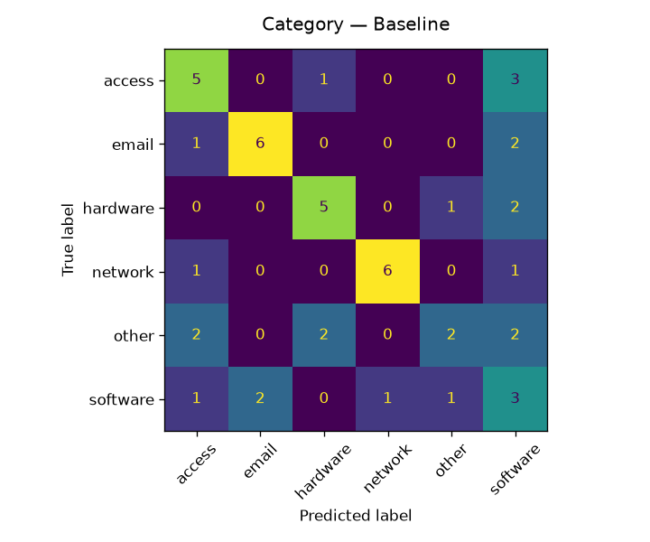
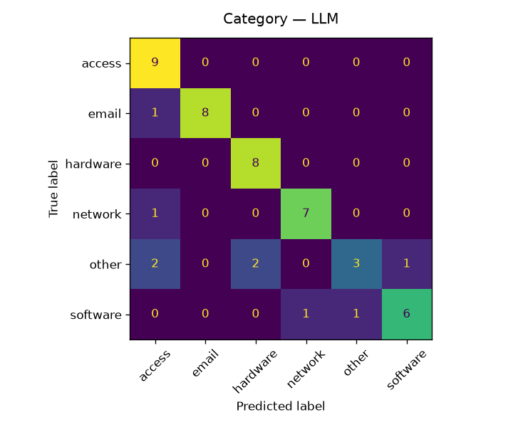
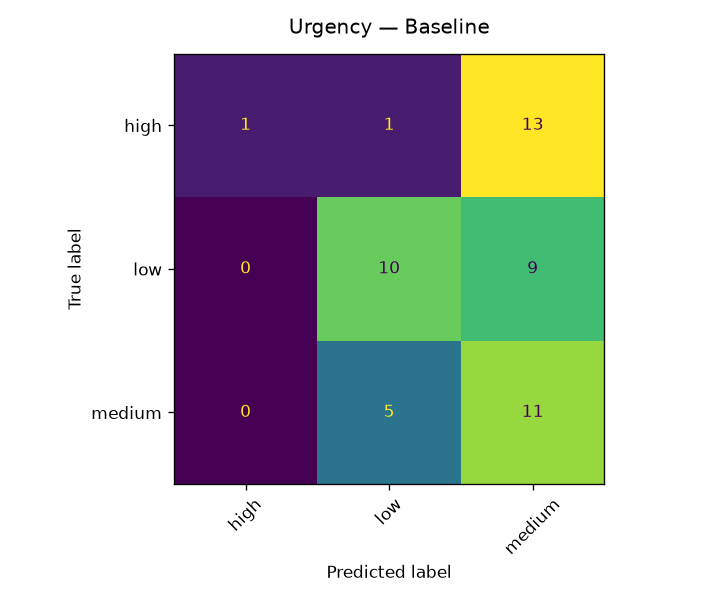
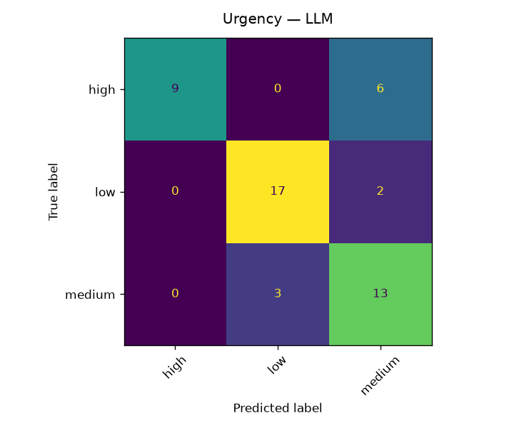

# Classifier Evaluation Report

Generated: 2026-11-01 12:48 UTC  
Eval set: 50 tickets (stratified by category, seed=42)

## Summary

| Metric | Baseline (TF-IDF + LR) | LLM (claude-haiku-5-5) |
|---|---|---|
| Cat accuracy | 0.540 | 0.820 |
| Cat macro F1 | 0.546 | 0.804 |
| Urgency accuracy  | 0.440 | 0.780 |
| Urgency macro F1  | 0.382 | 0.775 |
| Avg latency / ticket | — | 1.91 s |
| Est. cost / 1,000 tickets | — | $1.411 |

> Cost estimate uses haiku-tier pricing ($1.00/M input, $5.00/M output tokens).

## Confusion Matrices

### Category — Baseline

### Category — LLM

### Urgency — Baseline

### Urgency — LLM

## Top Disagreements (LLM ≠ Baseline)

| Ticket | Subject | Ground truth | Baseline | LLM |
|---|---|---|---|---|
| 9e8d7c6b… | Remove old device from MFA profile | access / low | hardware / low | access / medium |
| bd9e8f7a… | Access to Azure DevOps repo | access / low | software / medium | access / low |
| a0d9c3e7… | Desk phone display shows error code | hardware / low | software / medium | hardware / low |
| d5a9f3b1… | Wrong name on my office door sign | other / medium | software / low | other / medium |
| 3c8f1a6e… | Ransomware warning popup, unsure what to do | software / high | email / medium | other / high |
